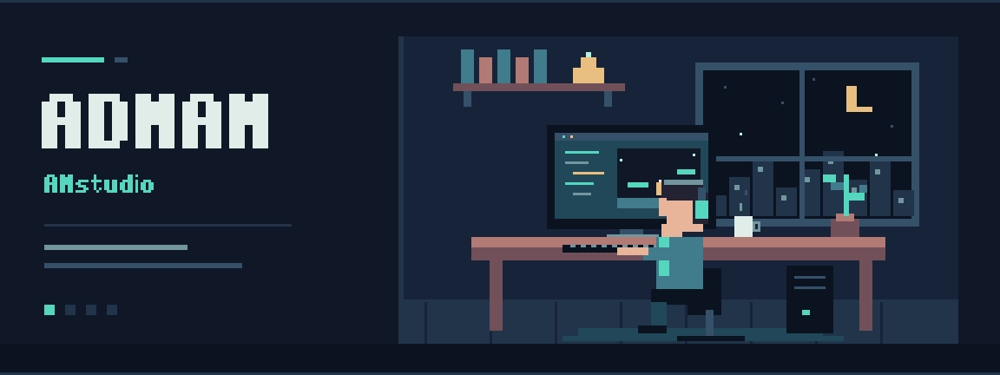
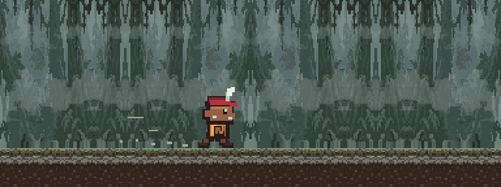

  

<h1 align="center">Hi, I'm Adnan.</h1>

<strong>Aspiring game developer · Curious about how games are made.</strong>

  <a href="https://github.com/adnannpm?tab=repositories">Explore my repositories</a>
  &nbsp; / &nbsp;
  <a href="https://github.com/adnannpm?tab=stars">Things that inspire me</a>

---

### Behind the screen

I'm interested in game development — the code, the art, and the small details that make an interactive world feel alive.

This is my space to learn, experiment, and share what I build.

### Creative direction

- **Gameplay** — exploring the ideas behind responsive, enjoyable interactions.
- **Pixel art** — an appreciation for expressive characters and worlds built one pixel at a time.
- **Iteration** — starting small, staying curious, and making each version a little better.

### Explore my work

Browse my [repositories](https://github.com/adnannpm?tab=repositories) for code and experiments. Featured work lives in the pinned repositories on this profile.

---

Original pixel studio artwork made in Aseprite · <a href="assets/pixel-studio.aseprite">Editable source</a> · <a href="assets/pixel-studio.png">Still image</a>

<!--START_SECTION:profile-date-->

Profile refreshed automatically · 21 October 2026 · WIB (UTC+7)

<!--END_SECTION:profile-date-->

---

  

A looping pixel-art tribute based on my game screenshot, animated in Aseprite — not a gameplay recording. · <a href="assets/first-game-run.aseprite">Editable source</a>

